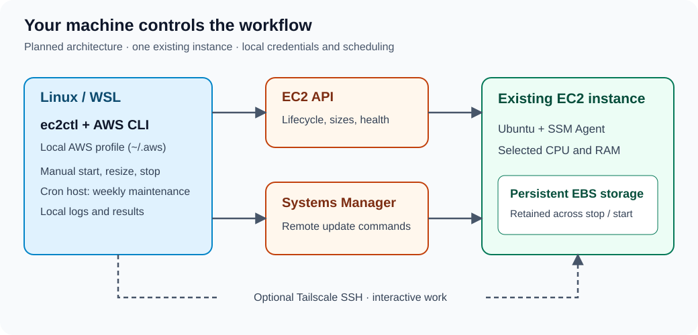
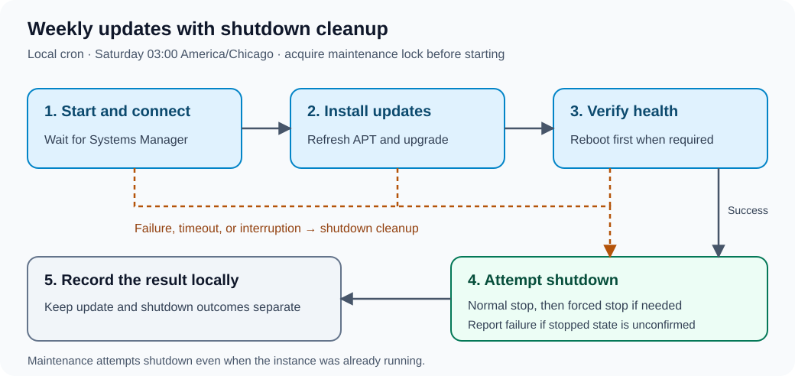

# EC2 Control Toolkit

A Bash toolkit for using an existing Amazon EC2 instance when you need it: choose its size, start it, connect to work, and stop it afterward. Scheduled maintenance keeps the Ubuntu guest updated through AWS Systems Manager.

**Project status:** Implemented. The CLI is configured for the private Ubuntu instance in `us-east-2`; lifecycle-changing live tests should only be run during an approved interruption window. See [AWS-Instance-Plan.md](AWS-Instance-Plan.md) for the full design.

## Why this exists

A personal cloud workstation does not always need to run around the clock. This toolkit aims to make its daily operation predictable from Linux or Windows through WSL, while keeping credentials on your own machines.

The scope is one existing EC2 instance with persistent EBS storage. It will manage that instance in place; it will not provision a replacement machine, manage a fleet, or resize storage when you select more CPU and RAM.

## How it works



- **Local control:** `ec2ctl` uses the AWS CLI and your selected local AWS profile to inspect, resize, start, and stop the configured instance.
- **Remote maintenance:** AWS Systems Manager runs Ubuntu package updates without requiring an interactive SSH session.
- **Interactive work:** Startup prints a Tailscale SSH command for you to run. It does not open a session automatically. Tailscale is needed only for this interactive connection.
- **Local scheduling:** An always-on Linux or WSL cron host owns the weekly maintenance schedule. There is no cloud scheduler or GitHub Actions workflow.

## Daily workflow

These examples use an AWS profile named `workstation`. Omit `--profile` to use the default profile.

```bash
# Inspect state, instance type, Systems Manager, and local maintenance results.
./bin/ec2ctl --profile workstation status

# List supported sizes with RAM and vCPU counts.
./bin/ec2ctl --profile workstation sizes

# Start using the current instance type.
./bin/ec2ctl --profile workstation start

# Alternatively, choose a type interactively before starting a stopped instance.
./bin/ec2ctl --profile workstation start --choose

# Or request a specific supported type.
./bin/ec2ctl --profile workstation start --instance-type t3.xlarge
```

After startup and health checks, run the printed `tailscale ssh ubuntu@aws.robertmccaleb.com` command. When finished, exit SSH and explicitly stop the instance:

```bash
./bin/ec2ctl --profile workstation stop
```

**Leaving SSH does not stop the instance.** There is no automatic runtime limit. Starting an already-running instance or stopping an already-stopped instance is intended to succeed safely.

Size changes require a stopped instance. The CLI will validate supported types, compatibility, and Availability Zone offerings before changing the type. An offered type does not guarantee available capacity. The selected type persists across stops and is reused by plain startup and maintenance. The instance ID and EBS volumes remain intact.

### How resizing affects Ubuntu

A compatible resize does not reinstall Ubuntu or require an OS update. After the stop, type change, and restart, Ubuntu detects the new CPU and memory automatically. For example, moving within the T3 family from `t3.large` (8 GiB and 2 vCPUs) to `t3.2xlarge` (32 GiB and 8 vCPUs) should require no guest changes.

Applications might still need tuning to use the added capacity. Fixed JVM heaps, database buffers, container limits, CPU affinity, or worker counts do not necessarily expand automatically, and single-threaded workloads do not benefit from additional CPUs. After resizing, verify the detected resources with `lscpu` and `free -h`, and check `systemctl --failed` for service problems.

Extra preparation may be required when changing processor architecture or moving between instance families with different virtualization, network, or storage interfaces. The CLI will reject incompatible types and validate requirements such as architecture, boot mode, ENA and NVMe support, and attached-volume limits before making a change. AWS documents these restrictions in its [instance-type compatibility guidance](https://docs.aws.amazon.com/AWSEC2/latest/UserGuide/resize-limitations.html).

EBS data persists through the required stop/start cycle, but RAM contents and any instance-store data do not. A non-Elastic public IPv4 address can also change after restart.

## Weekly maintenance



The schedule is **Saturday at 3:00 AM, America/Chicago**, on the local cron host. A missed run waits until the next Saturday; there is no automatic catch-up. Install it for the default AWS profile with:

```bash
./scripts/install-cron --profile default
```

Run maintenance manually only during an approved maintenance window:

```bash
./bin/ec2ctl --profile workstation maintain
```

Maintenance:

1. Acquire a local lock to prevent overlapping maintenance runs.
2. Start the instance if needed and wait for Systems Manager.
3. Run noninteractive `apt-get update` and `apt-get dist-upgrade -y`.
4. Reboot when required, verify the reboot, and check EC2 and Systems Manager health.
5. Attempt shutdown on success, failure, timeout, or interruption, and save the outcome locally.

**Maintenance will stop the instance even if it was already running.** Reserve the maintenance window and avoid working on it during that time.

AWS waits will have finite deadlines. Shutdown will try normal stopping first, then forced stopping if necessary; forced stopping can interrupt writes. Connectivity or AWS failures can prevent shutdown, so an unconfirmed stop will be reported as a failure. Successful cleanup will not erase an earlier update or verification failure.

Logs and maintenance results stay outside Git tracking. `status` will show the last result recorded on the current machine; records will not synchronize between computers. Automatic snapshots and external notifications are outside this version's scope.

## Prerequisites and configuration

The toolkit requires:

- Linux or Windows through WSL, Bash, and the AWS CLI.
- An existing compatible Ubuntu EC2 instance with EBS-backed storage.
- A local AWS profile under `~/.aws` with permissions scoped to the selected instance wherever AWS supports it.
- Systems Manager Agent installed and enabled, plus an EC2 instance role with `AmazonSSMManagedInstanceCore`.
- Tailscale on both ends when using the interactive Tailscale SSH workflow.
- An always-on, connected cron host with `flock` for scheduled maintenance.

The region, instance ID, hostname, supported types, and timeout values live in [`config/ec2ctl.conf`](config/ec2ctl.conf). They are not secrets. Each computer must configure its own AWS profile; credentials remain under `~/.aws`. Never commit credentials, SSH private keys, Tailscale credentials, command output, or maintenance logs.

Native Windows/PowerShell and macOS support are outside the initial scope.

## Costs while stopped

Stopping the instance avoids its running compute charges, but it does not remove persistent resources. EBS storage and allocated public or Elastic IPv4 resources need separate attention. The audit command reports resources associated with the configured instance and reminds you to review account-level resources separately:

```bash
./bin/ec2ctl --profile workstation cost-audit
```

## Repository and development

| Path | Purpose | Status |
| --- | --- | --- |
| `AWS-Instance-Plan.md` | Detailed implementation and acceptance plan | Available |
| `AGENTS.md` | Contributor guidelines | Available |
| `docs/images/` | SVG diagrams used in this README | Available |
| `config/ec2ctl.conf` | Non-secret instance and timeout configuration | Available |
| `iam/ec2ctl-policy.json` | Least-privilege policy for the configured instance | Available |
| `bin/ec2ctl` | Bash CLI | Available |
| `tests/` | Tests using a fake `aws` executable | Available |
| `scripts/install-cron` | Idempotent local cron installer | Available |

There is no build step. Run syntax checks and the fake-AWS test suite with:

```bash
bash -n bin/ec2ctl
./tests/test_cli.sh
./tests/test_cron.sh
```

When ShellCheck is installed, also run `shellcheck bin/ec2ctl scripts/install-cron tests/*.sh`. The fake suite covers lifecycle transitions, option validation, status, patch success, shutdown cleanup, local maintenance records, and cost reporting. Live lifecycle tests require explicit authorization because they interrupt the instance.

Read [the contributor guidelines](AGENTS.md) and [the implementation plan](AWS-Instance-Plan.md) before contributing. Pull requests should explain behavior changes, validation, and any effects on IAM, scheduling, or shutdown.

## License

No license has been added yet. A license should be selected before this project is released for public reuse.
